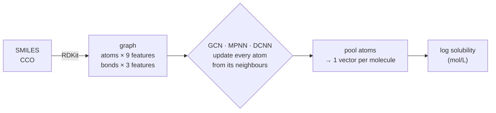
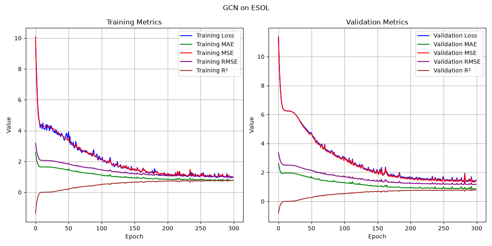
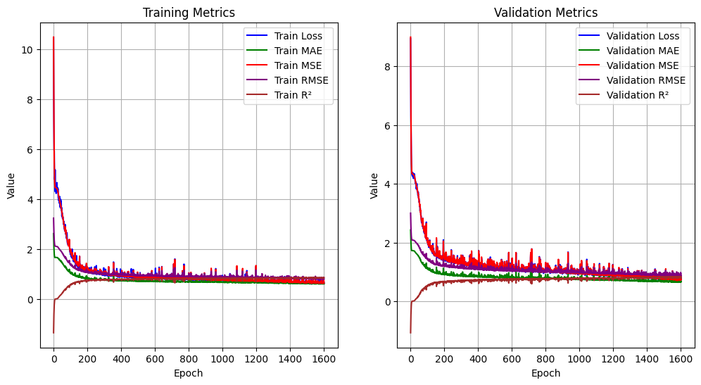
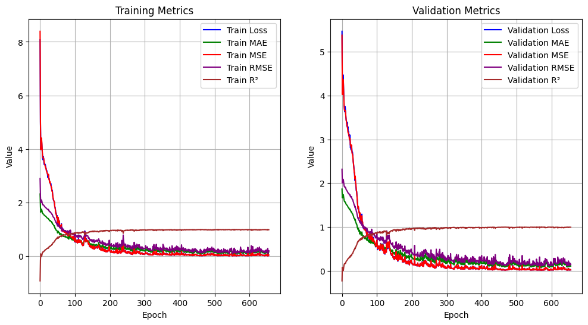
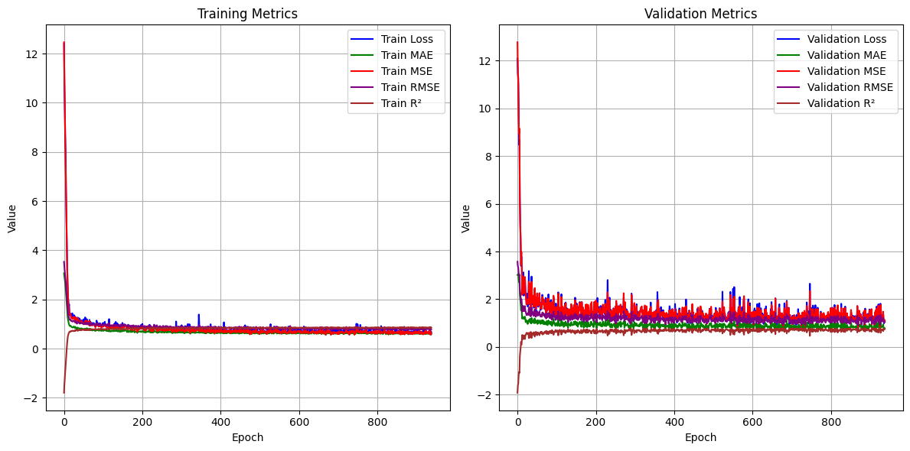

# Multi-Graph-NN

**Three graph neural networks (GCN, MPNN, DCNN) that predict how well a molecule dissolves in water, straight from its graph of atoms and bonds.**

[](LICENSE)
[](pyproject.toml)
[](https://pytorch.org)
[](https://pyg.org)
[](https://moleculenet.org/datasets-1)

A molecule is a graph: atoms are nodes, bonds are edges. This repository
implements three classic ways for a neural network to read that graph, and
trains all three on the same task, the MoleculeNet **ESOL** solubility
benchmark, with the same data split and metrics. The models are short,
readable PyTorch files, made for learning how GNNs work.



| Model | Idea | Uses bond types |
|-------|------|:---------------:|
| **GCN** | each atom averages its neighbours (graph convolution) | no |
| **MPNN** | neighbours send learned *messages* that depend on the bond | yes |
| **DCNN** | look 0, 1, …, K random-walk steps away at once (diffusion) | no |

## Quick start

```bash
# 1. install (Python >= 3.10)
python -m venv .venv
source .venv/bin/activate
pip install -e '.[dev]'

# 2. check everything works (CPU, no internet)
pytest

# 3. train (downloads ESOL on the first run, ~100 KB; a CPU is enough)
mgnn-train --model gcn        # or mpnn, dcnn

# 4. predict the solubility of any molecule
mgnn-predict --checkpoint checkpoints/gcn/best.pt "CCO" "c1ccccc1"
```

Training writes `best.pt`, `metrics.json`, `history.json` and `curves.png` to
`checkpoints/<model>/`.

## Results

### With this package (`mgnn-train`, default settings, seed 42, CPU)

Metrics of the best-validation checkpoint on the **112 held-out test molecules**
(RMSE and MAE in log(mol/L), lower is better; R², higher is better):

| Model | Parameters | Best epoch | Test RMSE | Test MAE | Test R² |
|-------|-----------:|-----------:|----------:|---------:|--------:|
| GCN   | 1,009  | 297 / 300 | 0.981 | 0.749 | 0.711 |
| MPNN  | 40,097 | running   |       |       |       |
| DCNN  | 1,791  | running   |       |       |       |

One seed on a small dataset, so differences of a few hundredths are noise.
The GCN was still improving at epoch 300; `--epochs 1000` would go further.



### Original notebook runs (`legacy/`)

The curves my notebooks produced while training each model (loss, MAE, MSE,
RMSE and R² per epoch, train on the left, validation on the right):

| GCN (1,600 epochs) | MPNN (650 epochs) | DCNN (930 epochs) |
|:---:|:---:|:---:|
|  |  |  |

The GCN and DCNN settle around R² ≈ 0.7 to 0.8 on validation. **The MPNN
curves are not a held-out score:** that notebook's loop trained on the
validation loader, so its "validation" R² of ~1.0 is fit, not generalisation.
The package fixes this (see [legacy/README.md](legacy/README.md)).

## Documentation

| Guide | What is inside |
|-------|----------------|
| [docs/training.md](docs/training.md) | install, train, every option, use from Python, how to read the metrics |
| [docs/architecture.md](docs/architecture.md) | how molecules become graphs and how each model works, with tensor shapes |
| [docs/testing.md](docs/testing.md) | the unit tests and what each one proves |
| [legacy/README.md](legacy/README.md) | the original notebooks and what changed on the way to the package |

## Use it from Python

```python
from mgnn.predict import load_model, predict

model, cfg = load_model("checkpoints/mpnn/best.pt")
print(predict(model, ["CCO", "c1ccccc1"]))      # log(mol/L), one value per molecule
```

```python
from mgnn import Config, build_model            # build a model for your own graphs

model = build_model(Config.for_model("dcnn", hops=3))
out = model(x=batch.x.float(), e_idx=batch.edge_index, b_idx=batch.batch)   # [n_graphs, 1]
```

## Repository layout

```
src/mgnn/              the package (read in this order)
  config.py            every hyperparameter, with per-model defaults
  data.py              load ESOL, drop broken molecules, split 80/10/10, SMILES -> graph
  models.py            GCNModel, MPNN + MPNNModel, DCNN + GDCNNModel, build_model()
  metrics.py           MAE / MSE / RMSE / R² and the training-curve figure
  train.py             training loop, best-checkpoint selection, the mgnn-train command
  predict.py           load a checkpoint, the mgnn-predict command
tests/                 pytest suite (CPU only, offline, fake molecules)
docs/                  guides and figures
legacy/                the original GCN / MPNN / DCNN notebooks, kept for reference
pyproject.toml         dependencies and the mgnn-train / mgnn-predict commands
LICENSE                MIT
```

## Dataset

[ESOL](https://pubs.acs.org/doi/10.1021/ci034243x) (Delaney, 2004) via
[MoleculeNet](https://moleculenet.org/): 1,128 molecules with measured water
solubility in `log(mol/L)`. PyTorch Geometric downloads it and featurizes each
SMILES with RDKit. One molecule with an isolated atom is removed, leaving 1,127:
901 train, 114 validation, 112 test.

## License

[MIT](LICENSE)
