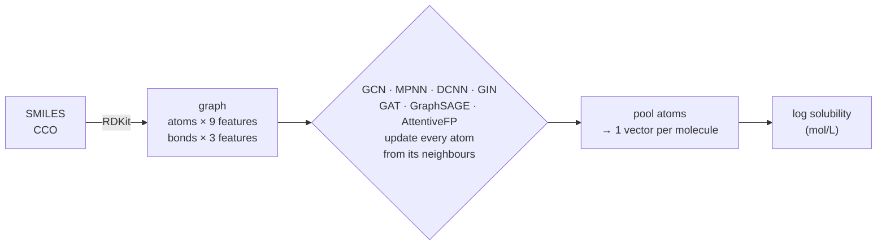
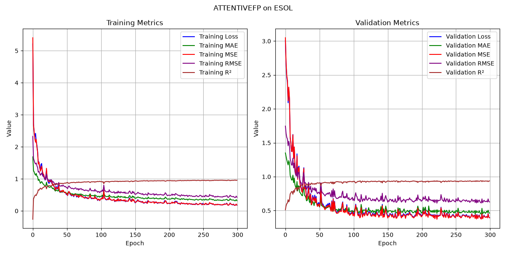
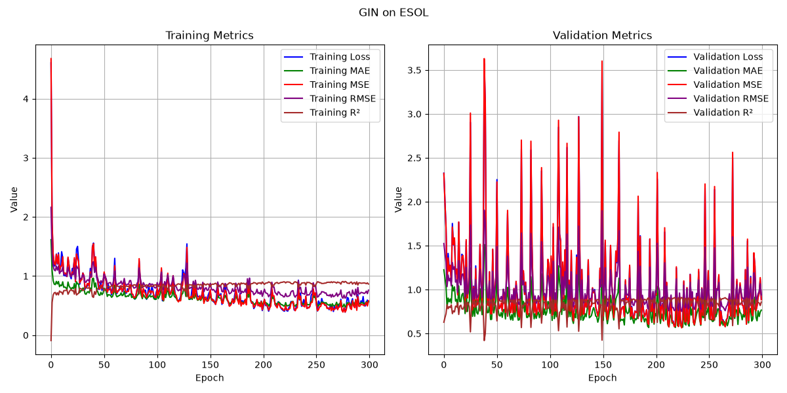
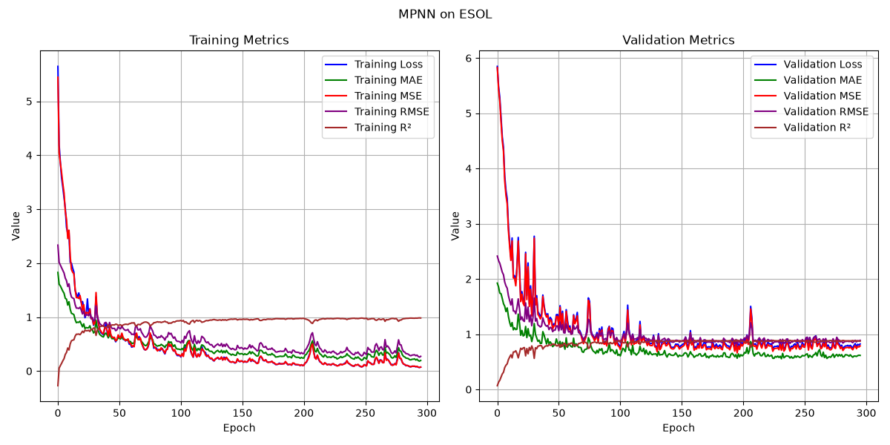
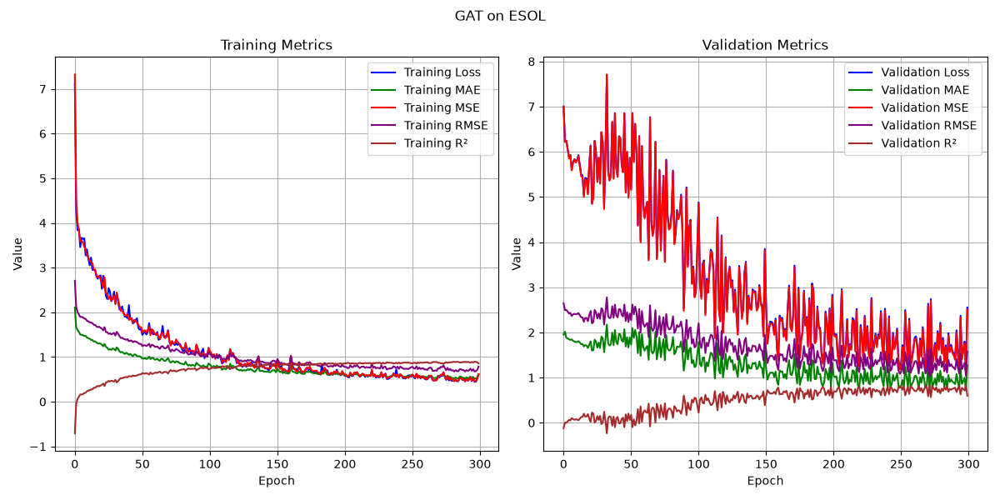
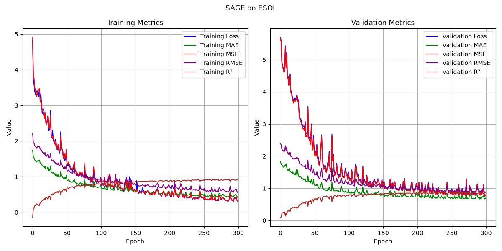
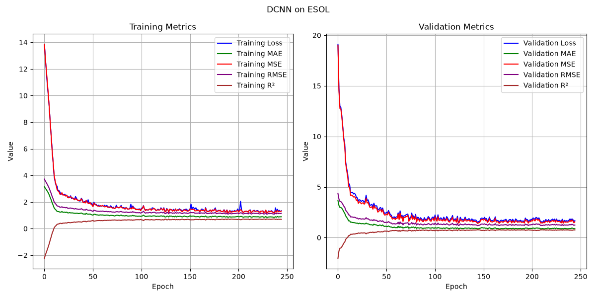

# GNN Molecular

**Seven graph neural networks (GCN, MPNN, DCNN, GIN, GAT, GraphSAGE, AttentiveFP) that predict how well a molecule dissolves in water, straight from its graph of atoms and bonds.**

[](LICENSE)
[](pyproject.toml)
[](https://pytorch.org)
[](https://pyg.org)
[](https://moleculenet.org/datasets-1)

A molecule is a graph: atoms are nodes, bonds are edges. This repository
implements seven well-known ways for a neural network to read that graph, and
trains all of them on the same task, the MoleculeNet **ESOL** solubility
benchmark, with the same data split and metrics. GCN, MPNN and DCNN are written
out by hand (from my original notebooks); GIN, GAT, GraphSAGE and AttentiveFP
are built from PyTorch Geometric layers. Every model is a short, readable
PyTorch class with the same interface, made for learning how GNNs work.

**Keywords:** graph neural networks (GNN), graph convolutional network (GCN),
message passing neural network (MPNN), diffusion convolutional neural network
(DCNN), graph isomorphism network (GIN), graph attention network (GAT, GATv2),
GraphSAGE, Attentive FP, PyTorch Geometric, RDKit, cheminformatics, molecular property
prediction, SMILES, MoleculeNet, ESOL, aqueous solubility, drug discovery.



| Model | Idea | Uses bond types | Paper |
|-------|------|:---------------:|-------|
| **GCN** | each atom averages its neighbours (graph convolution) | no | [Kipf & Welling, 2017](https://arxiv.org/abs/1609.02907) |
| **MPNN** | neighbours send learned *messages* that depend on the bond | yes | [Gilmer et al., 2017](https://arxiv.org/abs/1704.01212) |
| **DCNN** | look 0, 1, …, K random-walk steps away at once (diffusion) | no | [Atwood & Towsley, 2016](https://arxiv.org/abs/1511.02136) |
| **GIN** | sum the neighbours, then an MLP: as expressive as the WL graph test (GINE variant with bonds) | yes | [Xu et al., 2019](https://arxiv.org/abs/1810.00826), [Hu et al., 2020](https://arxiv.org/abs/1905.12265) |
| **GAT** | learn *how much* to listen to each neighbour (attention, GATv2) | yes | [Brody et al., 2022](https://arxiv.org/abs/2105.14491) |
| **GraphSAGE** | separate weights for "me" and "the mean of my neighbours" | no | [Hamilton et al., 2017](https://arxiv.org/abs/1706.02216) |
| **AttentiveFP** | attention between atoms + an attention readout over the molecule; built for chemistry | yes | [Xiong et al., 2020](https://pubs.acs.org/doi/10.1021/acs.jmedchem.9b00959) |

## Quick start

```bash
# 1. install (Python >= 3.10)
python -m venv .venv
source .venv/bin/activate
pip install -e '.[dev]'

# 2. check everything works (CPU, no internet)
pytest

# 3. train (downloads ESOL on the first run, ~100 KB; a CPU is enough)
mgnn-train --model gcn        # or mpnn, dcnn, gin, gat, sage, attentivefp

# 4. predict the solubility of any molecule
mgnn-predict --checkpoint checkpoints/gcn/best.pt "CCO" "c1ccccc1"
```

Training writes `best.pt`, `metrics.json`, `history.json` and `curves.png` to
`checkpoints/<model>/`.

## Results

### With this package (`mgnn-train`, default settings, seed 42, CPU)

Metrics of the best-validation checkpoint on the **112 held-out test molecules**
(RMSE and MAE in log(mol/L), lower is better; R², higher is better):

| Model | Parameters | Best epoch | Test RMSE | Test MAE | Test R² |
|-------|-----------:|-----------:|----------:|---------:|--------:|
| **AttentiveFP** | 888,201 | 222 (ran 300)           | **0.498** | **0.346** | **0.926** |
| GIN             | 35,585  | 224 (ran 300)           | 0.528 | 0.408 | 0.916 |
| MPNN            | 40,097  | 195 (early stop at 296) | 0.645 | 0.468 | 0.875 |
| GAT             | 35,329  | 271 (ran 300)           | 0.769 | 0.566 | 0.822 |
| GraphSAGE       | 33,793  | 298 (ran 300)           | 0.816 | 0.608 | 0.800 |
| DCNN            | 1,791   | 144 (early stop at 245) | 0.907 | 0.659 | 0.753 |
| GCN             | 1,009   | 297 (ran 300)           | 0.981 | 0.749 | 0.711 |

What the table says:

- **Bond features matter.** The four best models (AttentiveFP, GIN, MPNN, GAT) all
  read bond types; the three that only see atoms (GraphSAGE, DCNN, GCN) come last.
- **AttentiveFP**, the one model designed for chemistry, is best, but with 25×
  more parameters than GIN, which comes very close.
- **Sum beats mean.** GIN (sum aggregation) clearly beats GraphSAGE and GCN (mean
  aggregation): a sum can count neighbours, a mean cannot.

One seed on a small dataset (112 test molecules): differences of a few
hundredths are noise. To compare fairly, run each model with a few `--seed`
values. Models that stopped at 300 epochs were still improving slightly.

| AttentiveFP | GIN | MPNN |
|:---:|:---:|:---:|
|  |  |  |

| GAT | GraphSAGE | DCNN | GCN |
|:---:|:---:|:---:|:---:|
|  |  |  |  |

### Original notebook runs (`legacy/`)

The curves my notebooks produced while training each model (loss, MAE, MSE,
RMSE and R² per epoch, train on the left, validation on the right):

| GCN (1,600 epochs) | MPNN (650 epochs) | DCNN (930 epochs) |
|:---:|:---:|:---:|
|  |  |  |

The GCN and DCNN settle around R² ≈ 0.7 to 0.8 on validation. **The MPNN
curves are not a held-out score:** that notebook's loop trained on the
validation loader, so its "validation" R² of ~1.0 is fit, not generalisation.
The package fixes this (see [legacy/README.md](legacy/README.md)).

## Documentation

| Guide | What is inside |
|-------|----------------|
| [docs/training.md](docs/training.md) | install, train, every option, use from Python, how to read the metrics |
| [docs/architecture.md](docs/architecture.md) | how molecules become graphs and how each model works, with tensor shapes |
| [docs/testing.md](docs/testing.md) | the unit tests and what each one proves |
| [legacy/README.md](legacy/README.md) | the original notebooks and what changed on the way to the package |

## Use it from Python

```python
from mgnn.predict import load_model, predict

model, cfg = load_model("checkpoints/mpnn/best.pt")
print(predict(model, ["CCO", "c1ccccc1"]))      # log(mol/L), one value per molecule
```

```python
from mgnn import Config, build_model            # build a model for your own graphs

model = build_model(Config.for_model("dcnn", hops=3))
out = model(x=batch.x.float(), e_idx=batch.edge_index, b_idx=batch.batch)   # [n_graphs, 1]
```

## Repository layout

```
src/mgnn/              the package (read in this order)
  config.py            every hyperparameter, with per-model defaults
  data.py              load ESOL, drop broken molecules, split 80/10/10, SMILES -> graph
  models.py            GCNModel, MPNN + MPNNModel, DCNN + GDCNNModel (from the notebooks),
                       GINModel, GATModel, SAGEModel, AttentiveFPModel, build_model()
  metrics.py           MAE / MSE / RMSE / R² and the training-curve figure
  train.py             training loop, best-checkpoint selection, the mgnn-train command
  predict.py           load a checkpoint, the mgnn-predict command
tests/                 pytest suite (CPU only, offline, fake molecules)
docs/                  guides and figures
legacy/                the original GCN / MPNN / DCNN notebooks, kept for reference
pyproject.toml         dependencies and the mgnn-train / mgnn-predict commands
LICENSE                MIT
```

## Dataset

[ESOL](https://pubs.acs.org/doi/10.1021/ci034243x) (Delaney, 2004) via
[MoleculeNet](https://moleculenet.org/): 1,128 molecules with measured water
solubility in `log(mol/L)`. PyTorch Geometric downloads it and featurizes each
SMILES with RDKit. One molecule with an isolated atom is removed, leaving 1,127:
901 train, 114 validation, 112 test.

## License

[MIT](LICENSE)
