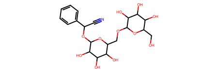

# How the data and the three models work

## Molecules as graphs

ESOL (from MoleculeNet) has 1,128 molecules, each with its measured water
solubility as `log(mol/L)`. PyTorch Geometric turns each SMILES string into a
graph with RDKit:

| Tensor | Shape | Meaning |
|--------|-------|---------|
| `x` | `[n_atoms, 9]` | atom features: atomic number, chirality, degree, formal charge, number of Hs, radical electrons, hybridization, aromatic, in ring |
| `edge_index` | `[2, 2·n_bonds]` | each bond stored twice (i→j and j→i), COO format |
| `edge_attr` | `[2·n_bonds, 3]` | bond type, stereo, conjugated |
| `y` | `[1, 1]` | log solubility (the regression target) |



*The first ESOL molecule (amygdalin): 32 atoms and 34 bonds, so `x` is `[32, 9]`
and `edge_index` is `[2, 68]`.*

**Cleaning** (`data.filter_dataset`): molecules with a single atom or with an atom
that has no bond are removed (nothing to pass messages along). On ESOL this removes 1
molecule: 1,128 → 1,127.

**Split** (`data.split_dataset`): shuffle once with the seed, then 80 / 10 / 10:
901 train, 114 validation, 112 test.

**Batching**: PyG merges a batch of molecules into one big disconnected graph,
plus a `batch` vector (`b_idx`) that says which molecule each atom belongs to.
Pooling uses `b_idx` to turn atom vectors back into one vector per molecule.

## The shared interface

```python
model(x, e_idx, b_idx, e_attr=None) -> [n_molecules, 1]
```

All seven models take the same arguments, so the training loop does not care
which one it is training. The loss is the mean squared error against `y`.

## GCN: graph convolution (`GCNModel`)

```
x [N, 9] ─ GCNConv → tanh ─ (× 4 layers, hidden 16) ─┬─ max pool ─┐
                                                      └─ mean pool ┴─ concat [B, 32] ─ Linear → [B, 1]
```

Each `GCNConv` replaces an atom's vector with a degree-normalised average of its
own vector and its neighbours' vectors, followed by a linear map. It only sees
atoms: bond types are ignored. After 4 layers each atom has seen 4 bonds in
every direction. Max and mean pooling together keep both "is there any atom
like this?" and "what is the average atom like?".

## MPNN: message passing with bond features (`MPNN`, `MPNNModel`)

One `MPNN` layer does three steps:

```
message:    m_ij = MLP_msg( [h_i ; h_j ; e_ij] )     [2·32 + 3] → 32
aggregate:  a_i  = Σ_j m_ij                           over neighbours j of i
update:     h_i' = MLP_upd( [h_i ; a_i] )             [2·32] → 32
```

The message depends on the **bond** `e_ij` as well as on the two atoms, so a
double bond can send a different message than a single bond. That is the main
difference from the GCN.

```
x [N, 9] ─ Linear → [N, 32] ─ (h = h + MPNN(h)) × 6 ─ mean pool [B, 32] ─ Linear → [B, 1]
```

The residual connection (`h + MPNN(h)`) makes 6 layers easy to train.

## DCNN: diffusion convolution (`DCNN`, `GDCNNModel`)

Instead of looking one bond away per layer, a DCNN layer looks at several
**random-walk distances at once**:

```
P   = D⁻¹ A          with D = degree + I        (row i: where a 1-step walk from atom i goes)
Π   = [P⁰, P¹, …, Pᴷ]                           (P⁰ = I = "stay on the atom")
H   = ReLU( Σ_k  W_k ⊙ (Pᵏ X) )                 one weight per (hop, feature)
```

`Pᵏ X` is the average of the features you reach after `k` random steps. Each hop
gets its own per-feature weight `W_k`, so the layer learns how much near and far
neighbourhoods matter.

```
x ─ BatchNorm ─ to dense [B, n_max, 9] ─ (x = x + DCNN(Π, x)) × 4 ─ mean over real atoms [B, 9] ─ MLP 9→128→1
```

It works on dense, padded tensors (`to_dense_adj`, `to_dense_batch`), so the
memory cost grows with the square of the largest molecule in the batch. The
mean pooling uses the padding mask, so padded rows never count.

## Four more standard GNNs

GIN, GAT, GraphSAGE and AttentiveFP use layers from PyTorch Geometric. GIN, GAT
and GraphSAGE share one simple recipe, so the only thing that changes between
them is the layer:

```
x [N, 9] ─ Linear → [N, 64] ─ (h = h + dropout(ReLU(layer(h)))) × 4 ─ pool [B, 128] ─ Linear → [B, 1]
```

| Model | One layer, for atom i | Pooling |
|-------|-----------------------|---------|
| **GIN** (`GINEConv`) | `h_i' = MLP( h_i + Σ_j ReLU(h_j + W·e_ij) )` | sum ; mean |
| **GAT** (`GATv2Conv`, 4 heads) | `h_i' = Σ_j α_ij · W h_j`, with attention `α_ij` computed from `h_i`, `h_j` and the bond `e_ij` | max ; mean |
| **GraphSAGE** (`SAGEConv`) | `h_i' = W1·h_i + W2·mean_j(h_j)` | max ; mean |

- **GIN** uses a *sum* and an MLP. A mean cannot tell one carbon neighbour from
  three, a sum can; this makes GIN as discriminative as the Weisfeiler-Lehman
  graph test. The GINE variant adds the bond features to every message.
- **GAT** learns a weight per neighbour instead of treating all neighbours
  equally. GATv2 fixes a limitation of the original GAT (its attention ranking
  could not depend on the receiving atom).
- **GraphSAGE** is the GCN with one change: the atom's own vector gets its own
  weight matrix, separate from its neighbours' mean.

**AttentiveFP** (`torch_geometric.nn.models.AttentiveFP`) was designed for
molecules. It runs graph attention with bond features over the atoms (GRU
updates), then reads out the molecule with a learned "super node" that attends
over all atoms for a few rounds, instead of a fixed mean or sum.

## Sanity properties (all checked in `tests/test_models.py`)

- **Permutation invariance**: renumbering the atoms of a molecule does not change
  its prediction (all seven models).
- **Permutation equivariance**: one MPNN layer's atom outputs move with the atoms.
- **Batch independence**: a molecule gets the same prediction alone or in a batch
  with bigger molecules (this caught padding leaking into the DCNN mean).
